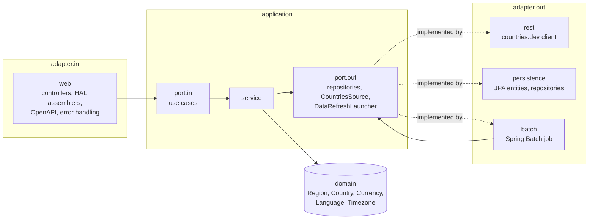
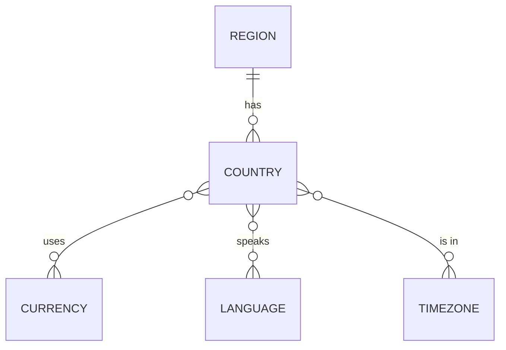

# Country Service

A small Spring Boot service that builds its own database of countries, regions, currencies, languages and timezones from [countries.dev](https://countries.dev), and serves it through a hypermedia REST API.

It does two things:

1. **Refreshes its data** with a Spring Batch job that downloads everything from countries.dev and upserts it into PostgreSQL.
2. **Serves the data** through a read-only HAL API with pagination and an OpenAPI specification.

## Documentation

| Page | Contents |
|---|---|
| [docs/data-refresh.md](docs/data-refresh.md) | How the batch job works, step by step, and how it handles errors |
| [docs/api.md](docs/api.md) | The API standard used, its structure, and where to find the OpenAPI specification |

## A note on purpose and scope

**This service is meant to be educational.** It is a place to practise and demonstrate architecture and framework features. It is not optimised, and it is not a template for production.

The batch job is the clearest example. Refreshing about 600 records could be a single service that calls the API and upserts the result. The job instead goes through intermediate ndjson files, partitioned parallel steps, chunking, fault-tolerant skipping, a flow and a final verdict step, because those are the Spring Batch features worth studying. It is far more machinery than the problem needs, and a simpler design would be easier to maintain.

Other things to keep in mind:

- The API has **no authentication**.
- The development profile uses an in-memory H2 database, and the data disappears when the application stops.

## Technologies

| Area | Technology |
|---|---|
| Language, build | Java 21, Maven |
| Framework | Spring Boot 3.5.16 |
| Batch | Spring Batch 5.2 |
| Persistence | Spring Data JPA, Hibernate 6.6, PostgreSQL |
| Schema migrations | Flyway 11 |
| REST API | Spring MVC, Spring HATEOAS 2.5 (HAL) |
| API documentation | springdoc-openapi 2.10 (OpenAPI 3.1, Swagger UI) |
| Mapping | MapStruct 1.6 |
| Boilerplate | Lombok |
| Development database | H2 (in memory, PostgreSQL mode) |

## Architecture

The project follows a **hexagonal (ports and adapters) architecture**. The core knows nothing about HTTP, JPA, Spring Batch or countries.dev. Everything outside the core is an adapter that plugs into a port, and **dependencies only point inwards**.



| Package | Responsibility |
|---|---|
| `domain` | Plain Java records and domain rules. No framework dependencies. |
| `application.port.in` | Use cases the outside world can invoke: query use cases and `RefreshDataUseCase`. |
| `application.port.out` | What the application needs from the outside: repositories, `CountriesSource` and `DataRefreshLauncher`. |
| `application.service` | Implementations of the use cases. |
| `adapter.in.web` | REST controllers, HAL model assemblers, response models, paging, error handling and the OpenAPI configuration. |
| `adapter.out.rest` | The countries.dev client. Implements `CountriesSource`. |
| `adapter.out.persistence` | JPA entities and Spring Data repositories. Implements the repository ports, including the upserts. |
| `adapter.out.batch` | The [data refresh](docs/data-refresh.md) Spring Batch job. Implements `DataRefreshLauncher` and drives the other ports. |

How the pieces fit together:

- **Domain objects are separate from JPA entities.** Adapters convert between them with [MapStruct](https://mapstruct.org) mappers declared in each adapter.
- **The batch job is an outbound adapter.** The web layer starts it through the `RefreshDataUseCase` and `DataRefreshLauncher` ports, and its steps read from `CountriesSource` and write through the repository ports.
- **Each adapter has its own models.** The REST client has its own DTOs, the ndjson files have their own line records, and the API has its own response models, so a change in one does not leak into the others.

### Data model



The schema is created by Flyway from `src/main/resources/db/migration`, and the Spring Batch metadata tables are created automatically.

## Build and run

**Requirements:** JDK 21 and Maven 3.9 or newer. There is no Maven wrapper.

```bash
mvn clean package        # compile, run the tests and build target/country-service-0.0.1-SNAPSHOT.jar
mvn test                 # tests only
```

### Run in development mode (no database needed)

The `dev` profile uses an in-memory H2 database and enables the OpenAPI specification and the debug logging of the batch job.

```bash
mvn spring-boot:run -Dspring-boot.run.profiles=dev
```

### Run against PostgreSQL

Start a database, for example with Docker:

```bash
docker run --rm --name countries-db -e POSTGRES_PASSWORD=secret -e POSTGRES_DB=countries -p 5432:5432 postgres:17
```

Then run the application with the connection settings in environment variables:

```bash
export DB_HOST=localhost DB_NAME=countries DB_USERNAME=postgres DB_PASSWORD=secret
mvn spring-boot:run
```

`DB_PORT` is optional and defaults to `5432`.

The first start creates the schema with Flyway. A database created by an earlier revision of the migration has to be dropped and recreated, because the initial migration has been edited in place during development.

### Try it

The application listens on port 8080. Load the data, then browse it:

```bash
curl -X POST http://localhost:8080/jobs/data-refresh    # starts the refresh, answers 202
curl http://localhost:8080/                             # entry point, follow the links
curl "http://localhost:8080/countries?size=5"
```

The OpenAPI specification and Swagger UI are described in [docs/api.md](docs/api.md#openapi-specification). With the `dev` profile, Swagger UI is at <http://localhost:8080/api-docs>.

### Configuration

| Property | Environment variable | Default | Purpose |
|---|---|---|---|
| `countries.export.output-dir` | `COUNTRIES_EXPORT_OUTPUT_DIR` | `./output` | Where the refresh writes its ndjson files |
| `countries.export.max-error-rate` | `COUNTRIES_EXPORT_MAXERRORRATE` | `0.05` | Share of skipped records a refresh step may have before the run counts as failed |
| `springdoc.api-docs.enabled` | `SPRINGDOC_API_DOCS_ENABLED` | `false` (`true` in `dev`) | Enables the OpenAPI specification and Swagger UI |
