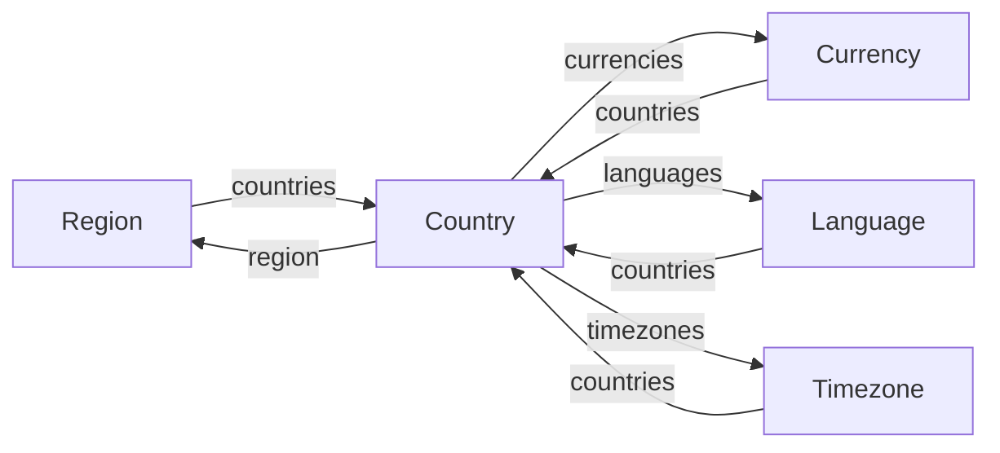

# API

The service exposes a **read-only, hypermedia REST API** built with [Spring HATEOAS](https://spring.io/projects/spring-hateoas). The only write-like operation is the [data refresh](data-refresh.md) trigger.

- [Conventions](#conventions)
- [Entry point](#entry-point)
- [Resources and endpoints](#resources-and-endpoints)
- [Representations](#representations)
- [Links](#links)
- [Pagination](#pagination)
- [Errors](#errors)
- [OpenAPI specification](#openapi-specification)

## Conventions

| Aspect | Standard used |
|---|---|
| Hypermedia format | [HAL](https://datatracker.ietf.org/doc/html/draft-kelly-json-hal) (`application/hal+json`) |
| Error format | [Problem Details, RFC 9457](https://www.rfc-editor.org/rfc/rfc9457) (`application/problem+json`) |
| Link templates | [URI Template, RFC 6570](https://www.rfc-editor.org/rfc/rfc6570) |
| Specification | [OpenAPI 3.1](https://spec.openapis.org/oas/v3.1.0), generated by springdoc |

- **Media types.** Responses are `application/hal+json`. A request with `Accept: application/json` gets the same HAL body with the plain JSON content type. Any other `Accept` value gets `406`.
- **Navigation.** Clients are meant to start at [`GET /`](#entry-point) and follow links. They should not build URLs by hand.
- **Identifiers.** Resources are identified by their **numeric database id**, for example `/countries/6`. Ids are assigned when a record is first stored and are not stable if the database is recreated. Every representation carries its own `id`, and all links use it.
- **No base path, no versioning** and **no authentication.** The API is not meant to be exposed as is.
- **Read-only.** Every `GET` is idempotent and side-effect free.

## Entry point

`GET /` lists the links to every collection:

```json
{
  "_links": {
    "self":       { "href": "http://localhost:8080/" },
    "regions":    { "href": "http://localhost:8080/regions" },
    "countries":  { "href": "http://localhost:8080/countries{?page,size}", "templated": true },
    "currencies": { "href": "http://localhost:8080/currencies{?page,size}", "templated": true },
    "languages":  { "href": "http://localhost:8080/languages{?page,size}", "templated": true },
    "timezones":  { "href": "http://localhost:8080/timezones{?page,size}", "templated": true }
  }
}
```

## Resources and endpoints

| Resource | Endpoint | Paged | Description |
|---|---|---|---|
| Root | `GET /` | no | Links to the collections |
| Regions | `GET /regions` | **no** (8 records) | All regions |
| | `GET /regions/{id}` | | One region |
| | `GET /regions/{id}/countries` | yes | Countries in the region |
| Countries | `GET /countries` | yes | All countries |
| | `GET /countries/{id}` | | One country |
| | `GET /countries/{id}/currencies` | yes | Currencies used in the country |
| | `GET /countries/{id}/languages` | yes | Languages spoken in the country |
| | `GET /countries/{id}/timezones` | yes | Timezones of the country |
| Currencies | `GET /currencies` | yes | All currencies |
| | `GET /currencies/{id}` | | One currency |
| | `GET /currencies/{id}/countries` | yes | Countries that use the currency |
| Languages | `GET /languages` | yes | All languages |
| | `GET /languages/{id}` | | One language |
| | `GET /languages/{id}/countries` | yes | Countries where the language is spoken |
| Timezones | `GET /timezones` | yes | All timezones |
| | `GET /timezones/{id}` | | One timezone |
| | `GET /timezones/{id}/countries` | yes | Countries that use the timezone |
| Data refresh | `POST /jobs/data-refresh` | | Starts a [data refresh](data-refresh.md). `202` when started, `409` if one is already running. |

Collections that hang off a resource (`/countries/{id}/currencies`) are **sub-resource paths**, not filters. If the parent does not exist the answer is `404`, not an empty page.

The relationships between resources:



## Representations

A resource carries its attributes and a `_links` object. Related resources are **never embedded**, only linked.

| Resource | Attributes |
|---|---|
| Region | `id`, `name` |
| Timezone | `id`, `timezone` (for example `UTC+05:30`), `utcOffset` (`+05:30`), `utcOffsetMinutes` (`330`, negative west of UTC) |
| Currency | `id`, `code`, `name`, `symbol` (nullable) |
| Language | `id`, `iso6392`, `iso6391` (nullable), `name` |
| Country | `id`, `alpha2Code`, `alpha3Code`, `numericCode` (string, leading zeros kept), `name`, `latitude` (nullable), `longitude` (nullable) |

Nullable attributes are always present, with the value `null`. For example, `iso6391` is `null` for 10 languages, and the US Minor Outlying Islands have no location.

```json
{
  "id": 6,
  "alpha2Code": "AD",
  "alpha3Code": "AND",
  "numericCode": "020",
  "name": "Andorra",
  "latitude": 42.5,
  "longitude": 1.5,
  "_links": {
    "self":       { "href": "http://localhost:8080/countries/6" },
    "region":     { "href": "http://localhost:8080/regions/6" },
    "currencies": { "href": "http://localhost:8080/countries/6/currencies{?page,size}", "templated": true },
    "languages":  { "href": "http://localhost:8080/countries/6/languages{?page,size}", "templated": true },
    "timezones":  { "href": "http://localhost:8080/countries/6/timezones{?page,size}", "templated": true }
  }
}
```

```json
{ "id": 24, "timezone": "UTC+05:30", "utcOffset": "+05:30", "utcOffsetMinutes": 330 }
```

## Links

| Resource | Link relations |
|---|---|
| Region | `self`, `countries` |
| Country | `self`, `region`, `currencies`, `languages`, `timezones` |
| Currency | `self`, `countries` |
| Language | `self`, `countries` |
| Timezone | `self`, `countries` |

Links to collections are **URI templates** (`{?page,size}`) with `"templated": true`. A HAL-aware client expands them. A plain client has to remove the template part before calling, or fill in the values.

## Pagination

Every collection except `/regions` is paged.

| Parameter | Default | Limits | Meaning |
|---|---|---|---|
| `page` | `0` | `>= 0` | Zero-based page index |
| `size` | `20` | `1` to `100` | Maximum elements per page |

The order is fixed and cannot be changed: regions by name, timezones by identifier, currencies by code, languages by ISO 639-2 code, countries by alpha-2 code.

A paged response contains the elements under `_embedded`, navigation links, and a `page` object:

```json
{
  "_embedded": { "countries": [ { "id": 1, "alpha2Code": "AF", "name": "Afghanistan", "...": "..." } ] },
  "_links": {
    "self":  { "href": "http://localhost:8080/countries?page=1&size=2" },
    "first": { "href": "http://localhost:8080/countries?page=0&size=2" },
    "prev":  { "href": "http://localhost:8080/countries?page=0&size=2" },
    "next":  { "href": "http://localhost:8080/countries?page=2&size=2" },
    "last":  { "href": "http://localhost:8080/countries?page=124&size=2" }
  },
  "page": { "size": 2, "totalElements": 250, "totalPages": 125, "number": 1 }
}
```

- `prev` is absent on the first page and `next` on the last.
- A page with no elements, such as `?page=999` or a country that uses no currency, has **no `_embedded`** property.
- The key under `_embedded` is the plural name of the resource: `countries`, `currencies`, `languages`, `timezones`, `regions`.

## Errors

All errors use `application/problem+json`:

```json
{
  "type": "about:blank",
  "title": "Not Found",
  "status": 404,
  "detail": "Country 999999 does not exist",
  "instance": "/countries/999999"
}
```

| Status | When |
|---|---|
| `400` | `page` is negative, `size` is outside 1 to 100, or an id is not a number. `detail` names the problem, for example `size must be between 1 and 100`. |
| `404` | The resource, or the parent of a sub-resource collection, does not exist. |
| `405` | Method not allowed, for example `PUT /countries`. |
| `406` | `Accept` asks for a media type the API does not produce. |
| `409` | `POST /jobs/data-refresh` while a refresh is running (`detail`: `A data refresh is already running`). |

The data refresh endpoint answers `202` with `{ "jobExecutionId": 1, "status": "STARTING" }`.

## OpenAPI specification

The specification is generated from the code by [springdoc-openapi](https://springdoc.org).

| What | Where |
|---|---|
| Specification, JSON | `/v3/api-docs` |
| Specification, YAML | `/v3/api-docs.yaml` |
| Swagger UI | `/api-docs` (redirects to `/swagger-ui/index.html`) |

It is **disabled by default** (`springdoc.api-docs.enabled=false`) and enabled by the `dev` profile. To enable it elsewhere, set `SPRINGDOC_API_DOCS_ENABLED=true`. There is no authentication in front of it, so keep it disabled where the service is reachable by others.

What the generated document contains:

- 19 operations, grouped by tag in this order: *Data refresh*, *Root*, *Countries*, *Currencies*, *Languages*, *Regions*, *Timezones*. Paths follow the same order.
- Explicit operation ids such as `listCountries`, `getCountry` and `listCountryTimezones`.
- Both media types for every success response, `application/hal+json` and `application/json`.
- The error responses of each operation, using Spring's `ProblemDetail` as the schema.
- Documented `page` and `size` parameters, with their defaults and limits.
- Nullable attributes marked as nullable.

How it is built, if you need to change it:

- Controllers declare `produces` for both media types and a `@Tag`. The status and the error responses come from two small composed annotations, `@ItemResponses` and `@PageResponses` (`adapter/in/web/openapi`).
- Declaring any `@ApiResponse` on an operation makes springdoc stop generating the default `200`, which is why those annotations list it.
- `OpenApiConfig` holds the API title and version, the paging parameter description and the tag and path order.
- In the generated document, `_links` is a generic map from relation name to link. The relations of each resource are documented in [Links](#links) above, not in the specification.
