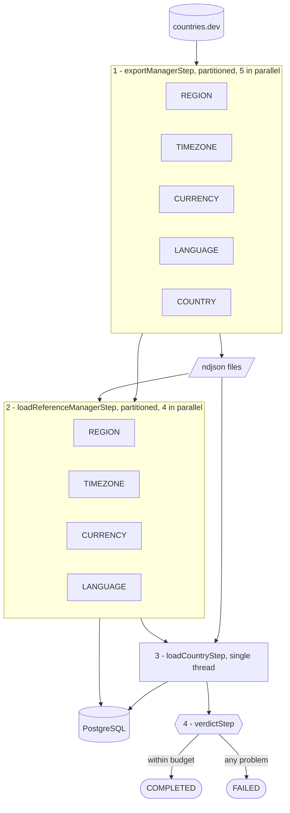

# Data refresh

The data refresh is a Spring Batch job that downloads countries, regions, currencies, languages and timezones from [countries.dev](https://countries.dev) and stores them in the database. It is the only way data gets into the service.

- [Triggering a refresh](#triggering-a-refresh)
- [How the process works](#how-the-process-works)
- [Upsert semantics](#upsert-semantics)
- [Error management](#error-management)
- [Observing a run](#observing-a-run)
- [Configuration](#configuration)
- [Known limitations](#known-limitations)

## Triggering a refresh

```bash
curl -X POST http://localhost:8080/jobs/data-refresh
```

```json
{ "jobExecutionId": 1, "status": "STARTING" }
```

| Response | Meaning |
|---|---|
| `202 Accepted` | The refresh was started. The job runs asynchronously, so the call returns immediately. |
| `409 Conflict` | A refresh is already running. Only one run is allowed at a time. |

Every call creates a new job instance (the `startedAt` job parameter is the current time), so runs are independent and there is no restart semantic. The job is called `dataRefresh`.

## How the process works

The job has four stages. The first two run their work in parallel, one partition per entity.



A stage always starts after the previous one finishes, **whatever its outcome**. The job does not stop at the first failure. See [Error management](#error-management).

### 1. Export: countries.dev to files

`exportManagerStep` splits the work into five partitions, one per entity, each running `exportWorkerStep` on its own thread (`export-1` to `export-5`).

| Entity | Request | Paging |
|---|---|---|
| Region | `GET /regions` | none, one call |
| Timezone | `GET /timezones?fields=timezone` | none, one call |
| Currency | `GET /currencies?sort=code&order=asc&limit=50&offset=N` | pages of 50 |
| Language | `GET /languages?fields=name,iso639_1,iso639_2&sort=iso639_1&order=asc&limit=50&offset=N` | pages of 50 |
| Country | `GET /countries?fields=region,name,latlng,numericCode,alpha2Code,alpha3Code,languages,currencies,timezones&sort=numericCode&order=asc&limit=50&offset=N` | pages of 50 |

A paged entity is read page after page until the API returns an **empty page**. Regions and timezones are small and are read, processed and written as one chunk. The other entities are written in chunks of 50.

Each partition writes one file in the output directory (`./output` by default). The file is deleted and recreated when the step starts, so a failed export can leave a partial file behind.

| File | Line format |
|---|---|
| `region.ndjson` | `{"name":"Americas"}` |
| `timezone.ndjson` | `{"timezone":"UTC-11:00"}` |
| `currency.ndjson` | `{"code":"AFN","name":"Afghan afghani","symbol":"؋"}` |
| `language.ndjson` | `{"name":"Afrikaans","iso6391":"af","iso6392":"afr"}` |
| `country.ndjson` | `{"region":"Europe","name":"Andorra","latlng":[42.5,1.5],"numericCode":"020","alpha2Code":"AD","alpha3Code":"AND","languages":[{"name":"Catalan","iso6391":"ca","iso6392":"cat"}],"currencies":[{"code":"EUR","name":"Euro","symbol":"€"}],"timezones":["UTC+01:00"]}` |

One JSON object per line ([ndjson](https://github.com/ndjson/ndjson-spec)). The line formats are the contract of the files and are defined in `NdjsonRecords`, independent of the domain model. Field names are camel case, and `latlng` is `null` when a country has no known location.

API calls are protected by a retry policy: up to 3 attempts with exponential backoff (500 ms, doubled, capped at 5 s) for network errors, `5xx` and `429`. Timeouts are 5 s to connect and 10 s to read. Other `4xx` responses are not retried.

### 2. Load reference data: files to database

`loadReferenceManagerStep` reads the files of the four entities that have no foreign keys, one partition each, in parallel (`load-1` to `load-4`). Because none of them references another, they cannot conflict with each other. Each line is turned into a domain object and passed to the matching repository port, which upserts it.

### 3. Load countries

`loadCountryStep` reads `country.ndjson` in chunks of 50 on a single thread. A country references a region, currencies, languages and timezones, so it must run after stage 2. The repository stores each country together with its links.

### 4. Verdict

`verdictStep` inspects the outcome of every data step and decides whether the run as a whole is a success. It is described under [Error management](#error-management).

## Upsert semantics

Every entity is matched by its **natural key**. A matching row is updated, a missing one is inserted.

| Entity | Natural key |
|---|---|
| Region | `name` |
| Timezone | `timezone` (for example `UTC+01:00`) |
| Currency | `code` |
| Language | `iso639_2` (`iso639_1` is missing for some languages) |
| Country | `alpha2_code` |

Rules that follow from this:

- **Nothing is ever deleted.** A record that disappears from the source stays in the database. A run can add and update data, never remove it.
- **Links are only added.** A currency, language or timezone link that is no longer in the source is not removed.
- **Unchanged rows are not rewritten.** Hibernate only writes rows whose values changed, so `updated_at` moves only when the data does. A second run over unchanged data writes nothing.
- **Missing languages are created.** The source's language list does not contain every language that countries reference (for example `zsm`, Malaysian). The country step creates such a language from the data embedded in the country. Existing languages are not modified.
- **Timezone offsets are derived.** `utc_offset` (`+05:30`) and `utc_offset_minutes` (`330`) are computed from the identifier. An identifier that is not `UTC` or `UTC±HH:MM` is rejected as an invalid record.

## Error management

The goal is to **import as much data as possible while not reporting a run as successful when too much went wrong**.

### Two kinds of error

| Kind | Examples | Handling |
|---|---|---|
| **Data error** in a single record | unparseable line, unsupported timezone identifier, database constraint violation, a country whose region, currency or timezone does not exist | The record is **skipped**, a `WARN` line is logged, the rest of the chunk and the run continue. |
| **Systemic error** | database unreachable, I/O failure, countries.dev unavailable after the retries | **Never skipped.** The step fails immediately. Skipping thousands of records would only hide an outage. |

The classification is explicit. The skip policy (`DataErrorSkipPolicy`) skips only `InvalidRecordException`, `UnsupportedTimezoneException`, `DataIntegrityViolationException` and `FlatFileParseException`. Any other exception, including programming errors such as `NullPointerException`, fails the step.

### How a record is skipped

The load steps are fault-tolerant Spring Batch steps. When a chunk of 50 fails on a data error, Spring Batch rolls it back and processes its records one by one, each in its own transaction. The bad record is isolated and skipped, and the other 49 are imported. This costs about 50 small transactions, and only for chunks that actually fail.

A skipped country is skipped **entirely**. A country is stored with all its links or not at all, never half-linked. This is also why one rejected currency cascades: every country that uses it fails its reference check and is skipped too.

### Error budget

Each data step (every export or load partition, and the country step) has a budget: the share of skipped records out of the records it processed.

```
skipped / processed  <=  max-error-rate      (default 0.05, i.e. 5%)
```

The budget is applied **per step**, not to the whole run. Over the whole run (about 1,230 records) 5% would allow ~60 errors, which could be all 8 regions. Per step, the allowed skips with the default are:

| Step | Records | Skips allowed |
|---|---|---|
| Regions | 8 | 0 |
| Timezones | 39 | 1 |
| Languages | 122 | 6 |
| Currencies | 163 | 8 |
| Countries | 250 | 12 |

### Continuing after failures

The job is a flow with wildcard transitions, so every stage runs even if an earlier one failed. This is safe because the load only adds and updates. If the timezone export fails, the database still holds the timezones from earlier runs, so the country load can still link to them, and the other four entities are still imported.

### The verdict

The last step, `verdictStep`, looks at every export worker, every reference-load worker and the country step. The run **fails** if any of them:

1. did not complete (for example a systemic error), or
2. processed no records at all (an empty source is suspicious), or
3. skipped more than the error budget allows.

If every step is clean, the job is `COMPLETED`. Otherwise the verdict marks the job `FAILED`, logs each problem at `WARN`, and stores the explanation as the exit message of the `verdictStep` execution, for example:

```
loadCountryStep skipped 36 of 250 records (14.4%, budget 5.0%)
```

A `FAILED` run does **not** roll anything back. It means the run needs attention. Everything that could be imported stays imported.

### Example outcomes

| Situation | Job | Result |
|---|---|---|
| Clean run | `COMPLETED` | everything imported, 0 skipped |
| 1 of 250 countries rejected by a database constraint | `COMPLETED` | 249 imported, 1 `WARN` line |
| Currency `EUR` rejected (cascade: 36 countries use it) | `FAILED` | 214 countries imported, verdict reports 36 of 250 (14.4%) |
| 15 of 250 countries rejected | `FAILED` at the default 5%, `COMPLETED` at 10% | 235 imported either way |
| Timezone export cannot write its file | `FAILED` | the other exports and the load still ran |
| Database table disappears during the load | `FAILED` | nothing skipped, the affected steps failed fast |

## Observing a run

**Logs.** Each step logs one `INFO` line when it ends:

```
Step exportWorkerStep:REGION COMPLETED in 274 ms: processed=8, successful=8, failed=0, filtered=0, commits=1, rollbacks=0
Step exportManagerStep COMPLETED in 715 ms: processed=582, successful=582, failed=0, filtered=0, commits=15, rollbacks=0
Data refresh checked 10 steps: 0 records skipped, all within budget
```

- `processed` is the number of records the step handled, including records skipped while reading.
- `successful` is the number written.
- `failed` is `processed - successful - filtered`. Spring Batch has no such counter, so it is derived. It covers skipped records and records lost in a chunk that failed.
- The manager steps (`exportManagerStep`, `loadReferenceManagerStep`) show totals aggregated over their partitions.

Every skipped record is logged at `WARN` with the step, the reason and the record itself:

```
Step loadCountryStep skipped a record: Currency 'EUR' does not exist | record: {"region":"Europe","name":"Andorra",...}
```

At `DEBUG` (enabled by default in the `dev` profile) each chunk adds a line with the cumulative counters:

```
Step loadCountryStep chunk committed: read=100, written=100, filtered=0, commits=2, rollbacks=0
```

The last chunk of a paged step shows no new records. It is the empty read that ends the step, and Spring Batch counts it as a commit.

**Database.** Spring Batch keeps its metadata in the `batch_*` tables, created automatically. The final status of a run is in `batch_job_execution`. The explanation of a failed verdict is in `batch_step_execution` (`exit_message` of the `verdictStep` row). The job-level exit message stays empty.

## Configuration

| Property | Environment variable | Default | Purpose |
|---|---|---|---|
| `countries.export.output-dir` | `COUNTRIES_EXPORT_OUTPUT_DIR` | `./output` | Directory of the ndjson files |
| `countries.export.max-error-rate` | `COUNTRIES_EXPORT_MAXERRORRATE` | `0.05` | Error budget per step |
| `logging.level.org.xmdf.countryservice.adapter.out.batch.logging` | | `INFO` (`DEBUG` in `dev`) | Chunk-level log lines |

The chunk size (50), the page size (50) and the retry policy are constants in the code.

## Known limitations

- **Single-instance guard.** The `409` check asks Spring Batch whether an execution is running. It is correct for one instance. Two instances sharing a database could both start a run.
- **Crashed runs.** An execution left unfinished by a crashed JVM stays in the `STARTED` state, and the guard would keep reporting a running refresh until it is cleaned up.
- **Failed export leaves a partial file.** The file is recreated when its export starts. A failure mid-way leaves what was written so far, and the load then upserts only that.
- **Inserts are not batched.** Identity ids stop Hibernate from batching inserts, so the first run issues about 1,500 single inserts.

## Why it is more complicated than it needs to be

A refresh of about 600 records could be a single service that calls the API and upserts. The job uses intermediate files, partitioned steps, chunking, fault tolerance and a flow on purpose, to exercise Spring Batch features. See the note in the [README](../README.md#a-note-on-purpose-and-scope).
